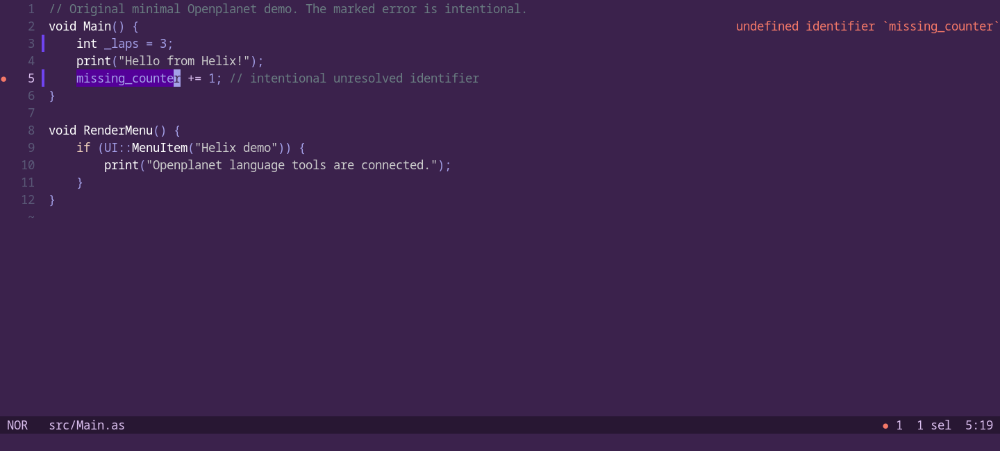

# Openplanet for Helix

AngelScript syntax and [Openplanet language server](https://github.com/clankercode/lsp-openplanet) configuration for [Helix](https://helix-editor.com/). This is a small configuration repository: no editor fork, runtime downloader, or npm package to install from this repo.



*Actual Helix running in Alacritty/tmux on a private Xvfb display. The original example intentionally references `missing_counter`; the error comes from openplanet-lsp 0.8.0. [Capture and verification details](docs/verification.md).*

## Install

Prerequisites: Helix **25.07.1 or later**, Python **3.11+**, Git and a working **C compiler** for the grammar. Linux was tested; macOS/Windows instructions have not been exercised in the editor. See [exact limits](docs/verification.md).

1. Install the server (recommended):

   ```sh
   npm install -g openplanet-lsp
   openplanet-lsp --version
   ```

   Alternatively use `cargo install openplanet-lsp` or the platform binary from [server releases](https://github.com/clankercode/lsp-openplanet/releases). The command must be available to the process starting Helix. This repo does not download or start a server until you install/configure it.

2. Clone and preview the additive install:

   ```sh
   git clone https://github.com/clankercode/lsp-openplanet-helix.git
   cd lsp-openplanet-helix
   python3 scripts/install.py --dry-run
   python3 scripts/install.py
   python3 scripts/build-grammar.py
   ```

   Use `python` instead of `python3` where appropriate. The installer appends definitions to `languages.toml` and adds two highlight query files in Helix's user runtime directory. It preserves existing TOML bytes, refuses conflicting definitions/query files, and makes no changes on `--dry-run`. An identical rerun is a no-op. Review partial/conflicting installs using [manual merge instructions](docs/configuration.md).

   The grammar builder fetches **only** the pinned AngelScript grammar into a temporary directory, compiles it and installs the library into your user runtime. It neither changes `use-grammars` nor fetches/builds all bundled Helix grammars. A different existing AngelScript library is refused; move it aside yourself before an intentional upgrade.

3. Restart Helix and open a plugin from its root (the directory containing `info.toml`):

   ```sh
   cd /path/to/plugin
   hx src/Main.as
   ```

   Check `hx --health angelscript` and `hx --health openplanet-info`. Use `]d` / `[d` to navigate diagnostics, `Space k` for hover and `Ctrl-x` in insert mode for completion. Helix supports the server's completion, diagnostics, hover, definition, references, rename, formatting and signature-help capabilities; only the explicitly recorded surfaces are live-tested here.

## Explicit server path

For a server outside Helix's PATH, pass an executable path (not a shell command):

```sh
python3 scripts/install.py --server-path /opt/openplanet/bin/openplanet-lsp
```

Windows example:

```powershell
python scripts/install.py --server-path 'C:\Tools\openplanet-lsp.exe'
python scripts/build-grammar.py --helix 'C:\Tools\helix\hx.exe'
```

Use the same options on subsequent installer runs. For an already-installed definition, edit its `command` in `languages.toml`; the installer refuses conflicting definitions rather than replacing them. Always retain `args = ["--lsp"]`: the bare server executable also has a terminal UI.

## TOML coexistence

Only `info.toml` selects the `openplanet-info` language, with TOML grammar and `language-id = "toml"`. Ordinary TOML retains Helix's existing configuration. The manifest uses **Openplanet LSP diagnostics plus Taplo** by default. Other TOML features, including formatting, remain with Taplo. Install an LSP-capable [Taplo release](https://github.com/tamasfe/taplo/releases) or `cargo install taplo-cli --locked --features lsp` if you want Taplo too. **The npm `@taplo/cli` package tested here does not include an LSP.**

If you use another TOML server already defined in Helix, choose it when installing:

```sh
python3 scripts/install.py --toml-server tombi
# Or manifest validation from Openplanet only:
python3 scripts/install.py --no-toml-server
```

Multiple `--toml-server` flags are allowed. Arrays are explicit: customize the manifest list to match your existing TOML servers. They are not inherited automatically. Existing ordinary TOML settings remain intact. [Configuration, optional .as includes and manual installation](docs/configuration.md).

## Troubleshooting

- **Server missing:** run `hx --health angelscript` from the same environment; use an absolute `command` if a GUI/terminal has a different PATH.
- **No syntax colors:** run the grammar builder, verify `runtime/queries/angelscript/highlights.scm`, then restart Helix. `hx --health` reports file presence; the [live test](scripts/live-smoke.py) also exercises actual grammar loading. Do not mistake successful health output for an ABI/query compatibility test.
- **`info.toml` has no plugin diagnostics:** check `hx --health openplanet-info`; inspect `:log-open`. A project `.helix/languages.toml` can override your user configuration. If another language has an exact `info.toml` glob, remove that ambiguity manually.
- **Taplo exits:** use a build with LSP support, or remove it from `openplanet-info.language-servers`. Missing optional servers can produce editor errors while Openplanet LSP still works.
- **Missing Openplanet/game types:** install Openplanet for your game, or set explicit server paths in `.openplanet-lsp.toml`; [upstream documentation](https://github.com/clankercode/lsp-openplanet) describes type DB setup. No fake fixture DB is shipped as a runtime default here.
- **Wrong workspace:** start Helix in the plugin directory or its parent workspace. Markers are `info.toml` and `.openplanet-lsp.toml`; without either, Helix uses its normal workspace/current-directory fallback. Opening from outside the plugin can change root discovery.
- **Runtime query errors after upgrade:** review the pinned grammar and queries as a unit. The shipped grammar has no indent/textobject queries; those health-check crosses are expected. Basic indent settings and LSP formatting remain available.

## Development and licensing

```sh
python3 -m unittest discover -s tests -v
```

CI runs these lightweight tests on Linux, macOS and Windows. The opt-in [real-editor smoke test](scripts/live-smoke.py) requires installed tools; see [verification](docs/verification.md). [Publishing and registry status](docs/publishing.md) describes distribution.

Original configuration, scripts, examples and docs: **Unlicense OR CC0-1.0**, your choice. Full texts: [UNLICENSE](UNLICENSE) and [LICENSE-CC0](LICENSE-CC0). The vendored AngelScript highlight query and fetched grammar are **BSD-3-Clause**, © 2026 Valeryi Savich; see [LICENSE-tree-sitter-angelscript](LICENSE-tree-sitter-angelscript) and [third-party provenance](docs/third-party.md). Helix and the server are separate upstream products and are not bundled.
